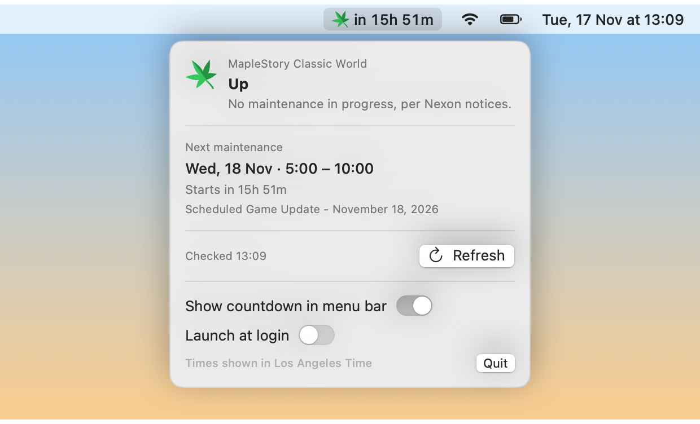

<p align="center">
  
</p>

# ms-classic-is-up

A tiny native macOS menu bar app that tells you whether **MapleStory Classic World** is up or down, and when the next maintenance is scheduled, in **your local time**.

The menu bar shows a maple leaf colored by status:

| | Status | Meaning |
|---|---|---|
|  | **Up** | No maintenance in progress |
|  | **Down for maintenance** | Shows when it's expected back |
|  | **Running late** | The announced end time has passed but Nexon hasn't marked the maintenance completed |
|  | **Unknown** | Nexon couldn't be reached yet |

Optional menu bar countdown: `in 2h 14m` before an upcoming maintenance (shown within 24 h), `ends 1h 03m` while it's running.

<p align="center">
  <picture>
    <source media="(prefers-color-scheme: dark)" srcset="docs/screenshot-dark.png">
    
  </picture>
</p>

## Install

Paste this into Terminal:

```sh
curl -fsSL https://raw.githubusercontent.com/Yozez/ms-classic-is-up/main/install.sh | bash
```

That's it. The script downloads the source, builds the app on your Mac, installs it to `~/Applications/MS Classic Is Up.app` and launches it. Look for the maple leaf in your menu bar. The app has no Dock icon.

Then open the app's menu and turn on **Launch at login** so it starts with your Mac.

**Requirements:** macOS 14 (Sonoma) or later, plus Apple's free Command Line Tools for Swift and git. If you don't have them, the installer tells you to run:

```sh
xcode-select --install
```

<details>
<summary>Other ways to install</summary>

**From a clone** (also works while you have SSH access to the repo):

```sh
git clone git@github.com:Yozez/ms-classic-is-up.git && ./ms-classic-is-up/install.sh
```

**With make**, from inside the repo:

```sh
make install   # build, copy to ~/Applications and launch
```

**Why build from source?** The app isn't notarized by Apple. A downloaded prebuilt copy would be blocked by Gatekeeper, but a copy built on your own Mac opens normally.

</details>

### Update

Run the same install command again. It replaces the installed copy and relaunches it.

### Uninstall

Turn off **Launch at login** in the app's menu first, then:

```sh
pkill -x MSClassicTray; rm -rf ~/Applications/"MS Classic Is Up.app"
```

## Development

```sh
make test      # run unit tests
make app       # build "build/MS Classic Is Up.app" (ad-hoc signed)
make run       # build and run in the foreground
make screenshots  # re-render docs/screenshot-*.png and docs/leaf-*.png from live data
make clean
```

`make screenshots` draws the real popover offscreen under a mock menu bar strip, so it doesn't need Screen Recording permission.

### Headless / scripting

```sh
"build/MS Classic Is Up.app/Contents/MacOS/MSClassicTray" --status
# now:     17 Nov 2026 at 13:09 (America/Los_Angeles)
# state:   up
# next:    Scheduled Game Update - November 18, 2026
#          18 Nov 2026 at 5:00 → 18 Nov 2026 at 10:00
```

Exit code: `0` up, `1` maintenance / running late, `2` error.

To preview other states, set `MSC_NOW` to an ISO-8601 timestamp, e.g. `MSC_NOW=2026-11-18T14:00:00Z make run`.

## How it works

Nexon doesn't publish a live server-status API for Classic World, so the app reads Nexon's **official maintenance notices**:

1. Every 2 minutes (and on wake from sleep) it fetches the public news feed `https://g.nexonstatic.com/maplestory/cms/v1/news`, keeping posts with `isMSCW: true` and category `maintenance` from the last 30 days.
2. For each notice not yet titled `[Completed]`, it fetches the post and parses the **Times** block, e.g. `PST (UTC -8): 5:00 AM - 10:00 AM`, which has an explicit UTC offset. If the block is missing, it falls back to the prose ("starting on … at … PST", "last approximately N hours"). It also handles "extended until …" updates.
3. It converts the window to your Mac's time zone and compares it with the current time.

```
Sources/MSClassicCore/   fetching, parsing, status logic (unit tested against real Nexon posts)
Sources/MSClassicTray/   SwiftUI MenuBarExtra app
Tests/                   swift-testing suites + saved API fixtures
```

### Limitations

- The status reflects **announced** maintenance only. The app doesn't ping game servers, so an unannounced outage won't show until Nexon posts a notice.
- The parser relies on the wording Nexon uses today. If a notice can't be parsed, it's ignored rather than guessed at.

## Security & privacy

- **Sandboxed, least privilege.** The app runs in the macOS App Sandbox with the hardened runtime. Its only permission is outgoing network access. It can't read or write your files, and it asks for no other permissions.
- **No incoming attack surface.** It opens no ports and registers no URL schemes, file types or XPC services. It talks to exactly one host, `g.nexonstatic.com`, over HTTPS, and rejects redirects to anywhere else.
- **Treats downloaded content as untrusted.** HTML from Nexon is never rendered or loaded; it's only scanned as text. Response size, post size, the number of posts fetched, UTC offsets and maintenance durations are all bounded, and tests cover hostile inputs.
- **No data collection.** There's no telemetry, account or cookies, and nothing is sent except plain requests for Nexon's public news feed.
- **No third-party dependencies.** The app uses only Apple's frameworks.
- **Installer.** `install.sh` builds from source, runs nothing until it has fully downloaded, and only ever replaces its own app bundle. Like any `curl | bash` installer, it trusts this repository, so read it first if you like.

## Thanks

- **[Nexon / MapleStory](https://www.nexon.com/maplestory/news/maintenance)**: the official maintenance notices and public CMS feed are the app's only live data source. All times, titles and status come from Nexon.
- **[meowdb's Classic World server status page](https://meowdb.com/msclassic/server-status)**: used as a reference while researching. It confirmed that tracking Nexon's Classic maintenance notices is the practical way to follow server status. The app doesn't fetch any data from meowdb.

MapleStory is a trademark of Nexon. This is an unofficial fan project and is not affiliated with or endorsed by Nexon.

## License

See [LICENSE](LICENSE).
